

  

<b>Lee la tierra para vivir en ella.</b> · <i>Read the land to live in it.</i>

  <a href="../../releases/latest"><b>⬇ Descargar la última versión / Download the latest version</b></a>
  · <a href="#english">English below</a>

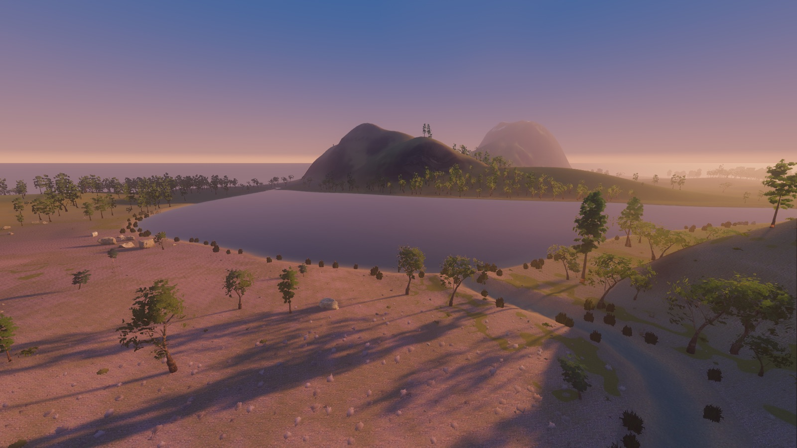

**Utmark** es un juego de supervivencia, exploración y construcción en una tierra salvaje del norte que aprendes a
leer. El nombre es la palabra escandinava para la tierra de fuera de la cerca de la granja: la que no se cultiva sino
que se recorre, y se aprovecha estación a estación.

En Utmark el paisaje se explica solo. La altura, el viento, el agua y la roca deciden dónde crecen los bosques, dónde
se acumula la nieve, dónde el suelo se vuelve juncal y dónde humea una caldera.

> **Estado:** en desarrollo, jugable. Se puede explorar, recolectar, fabricar, construir casas vikingas, cocinar,
> cazar con lanza y arco, pescar y jugar en cooperativo. Cada versión nueva llega con el actualizador del juego.

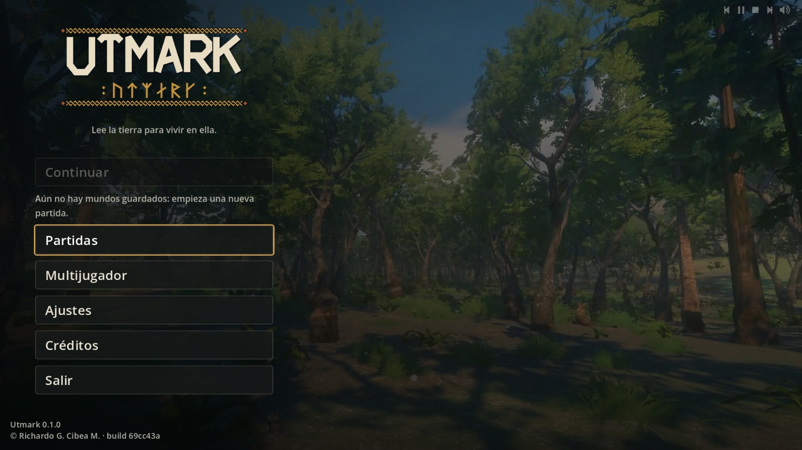

## El mundo

Cada semilla da un mundo propio (unos 10 km en el tamaño normal): tierras e islas, crestas, una costa irregular,
calderas, **ríos que bajan hasta el mar y lagos** con orillas suaves. Siete ecosistemas y el mar: Valles del Alba,
Sotos de Ámbar, Cuencas de Junco, Páramos de Sílex, Altos de Escarcha, Costas de Sal y Calderas de Ascua, cada uno con
su suelo, sus plantas, su luz y su tiempo. Nueve tipos de tiempo, de despejado a ventisca y lluvia de ceniza.

| | |
|---|---|
| 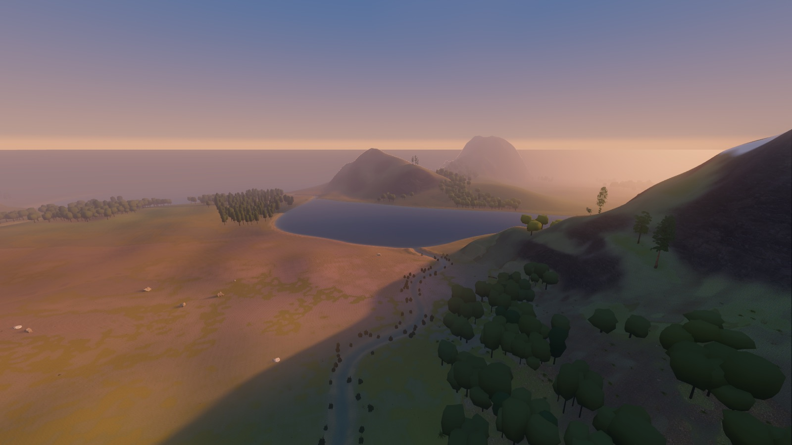 | 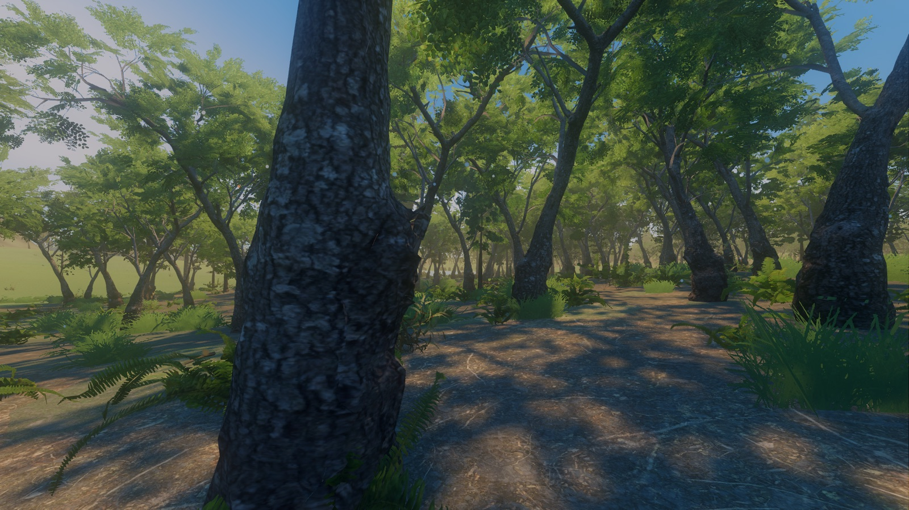 |
| 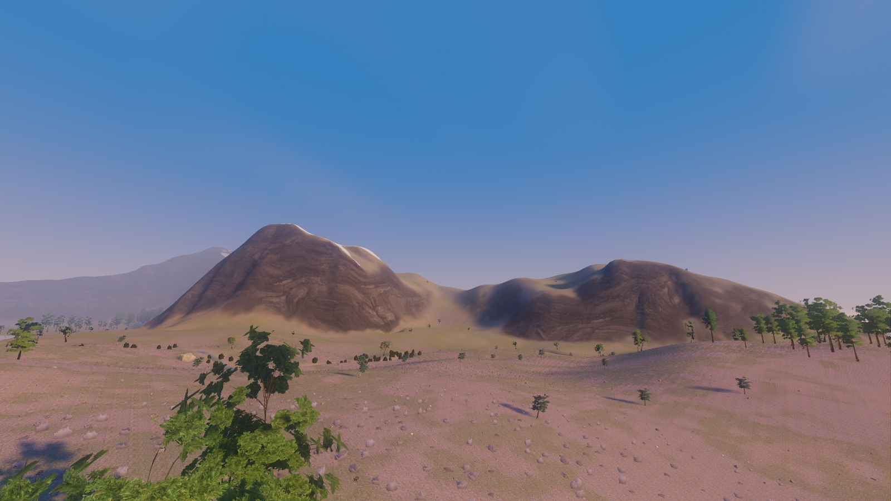 | 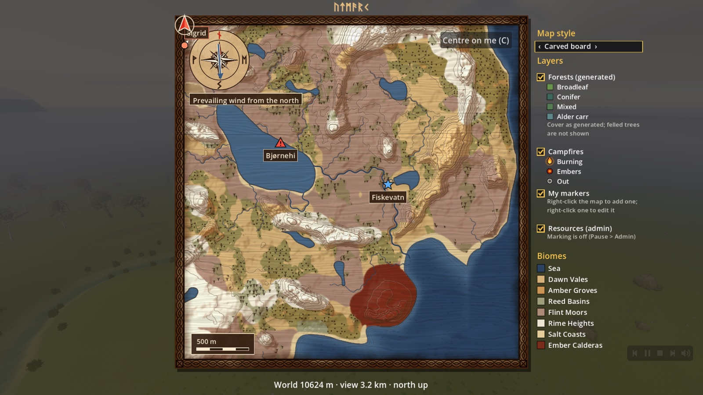 |

**El mapa** (M) se dibuja por defecto como una **tabla tallada**, con curvas de nivel, bosques, ríos, lagos, rosa de
los vientos y tus marcadores; hay otros tres estilos (mapa de campo, carta de vitela y relieve pintado).

## Sobrevivir

Salud, hambre y sed. El agua de río se bebe tal cual; la de lago hay que hervirla; la del mar es salada. Un día dura
40 minutos. De noche, una **antorcha de mano** (una rama y dos juncos) alumbra unos diez minutos; la lluvia la apaga si
no estás bajo techo. Si mueres, tus cosas quedan en un **túmulo de piedras** donde caíste: vuelve a por ellas.

| | |
|---|---|
| 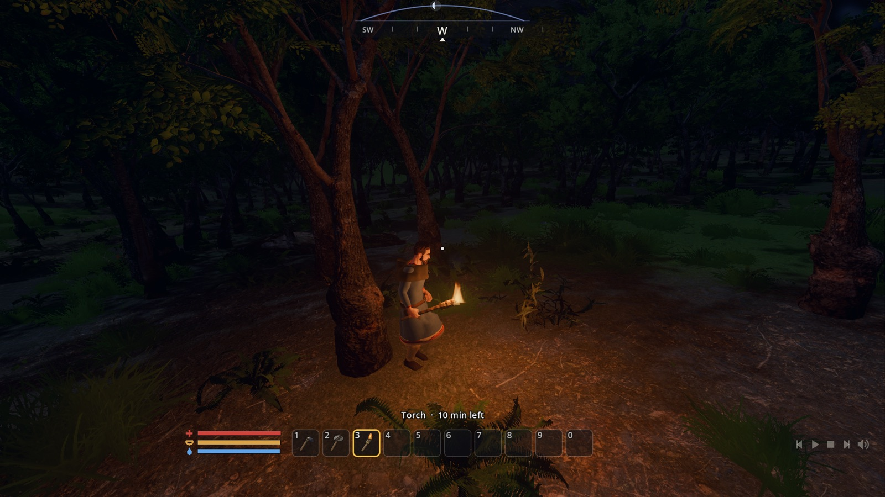 | 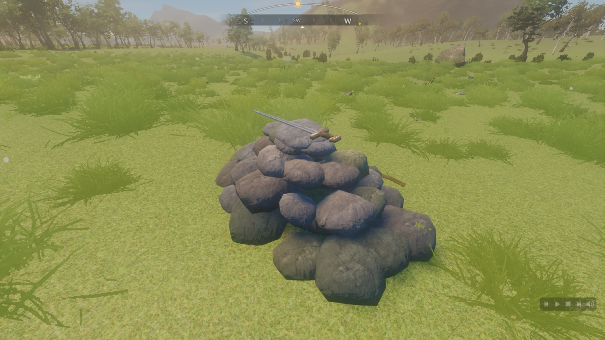 |

## Construir

B abre la construcción. Tres **casas de Hedeby** listas para levantar (la casa inicial de 6×4 m, la casa 1/7 de
12×6 m y la casa larga de 16×6 m) y sus piezas sueltas: muros de zarzo y barro, tejado de bálago, cumbreras de tepe,
suelo de arcilla, bancos, camas, hogares abiertos y horno. Las casas se asientan sobre un zócalo de tierra, con cabezas
talladas en los gabletes. Z desmonta la pieza que miras; mantener Z desmonta la casa entera y te devuelve lo que pagaste
y lo que había dentro. También: **pozo**, abrevadero y pila de lluvia para guardar agua.

| | |
|---|---|
| 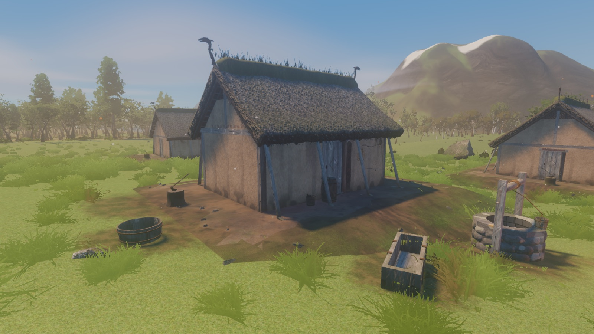 | 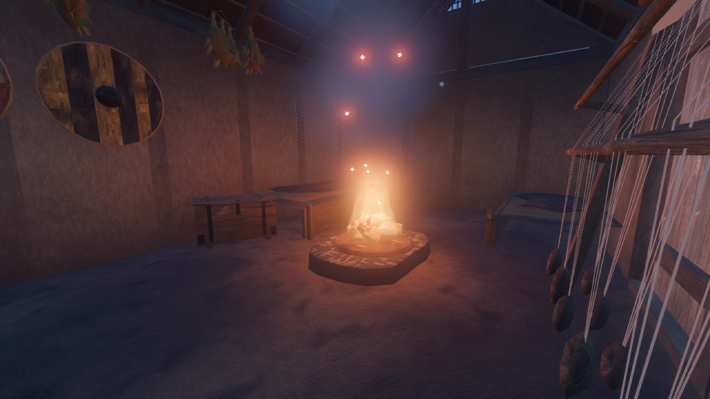 |
| 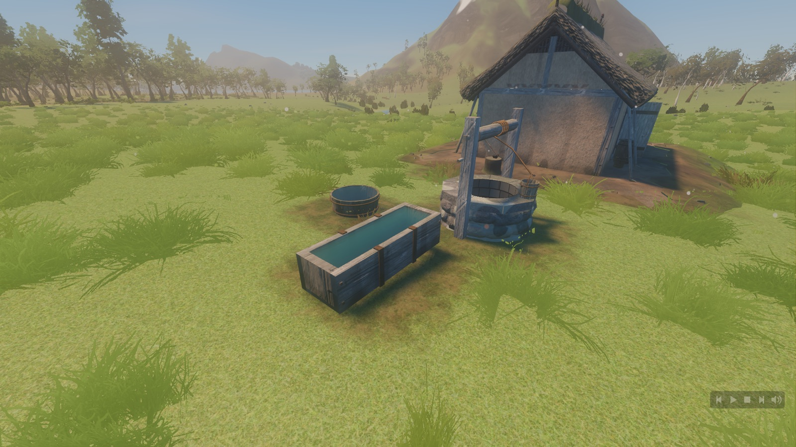 | 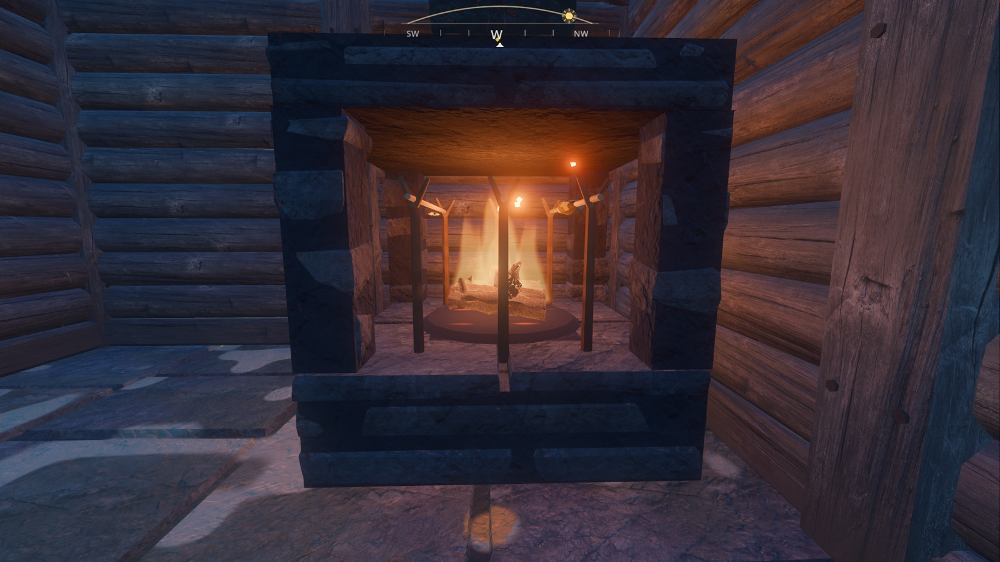 |

**Cocinar:** en una hoguera, un plato cada vez; en un hogar, tres a la vez, cada uno con su barra de progreso. Con O
cuelgas la olla de esteatita en su trípode sobre el fuego.

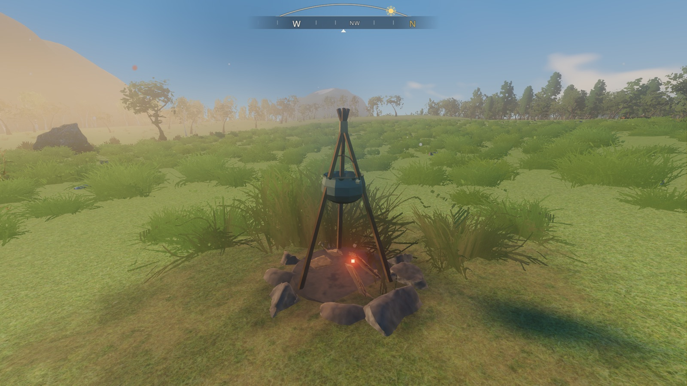

## Cazar

Ciervos y jabalíes. Lanza arrojadiza, caña de pescar y **arco** (dos ramas y una piel; flechas de sílex o de hueso).
Mantén el botón izquierdo para tensar: verás la trayectoria de la flecha, el punto de caída y el animal resaltado en rojo
cuando el tiro va a dar.

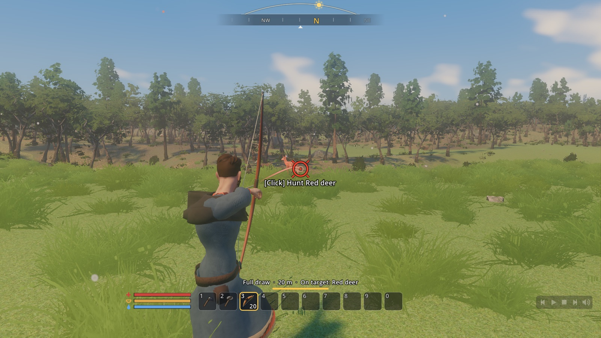

**Las runas del cazador:** talla un juego de runas (cuatro piedras, un sílex y un junco), arrodíllate en suelo firme y
lánzalas con una ofrenda de bayas. La lectura te dice hacia dónde y a qué distancia hay caza; con práctica, qué animal
y una zona marcada. Al llegar junto a los animales, las runas se cumplen.

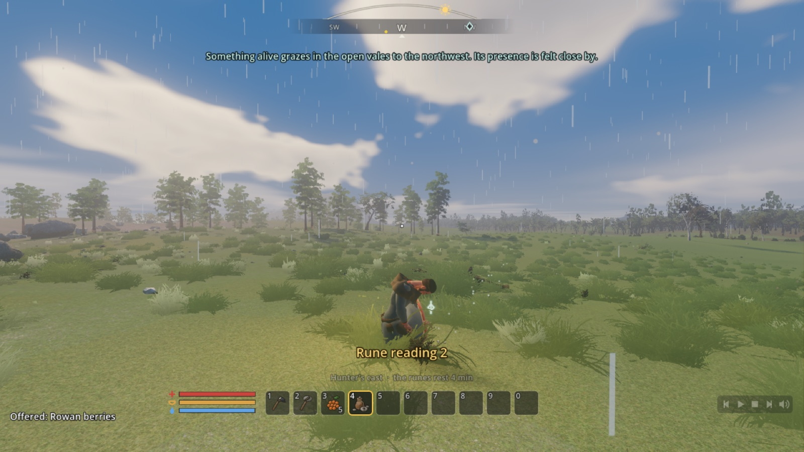

## Thor

En las tormentas, quien está a cielo abierto puede atraer la ira de Thor: el cielo se oscurece, Mjölnir se forma con
rayos sobre ti y caen tres rayos. Un techo o la copa de un árbol te resguardan. Al levantarte de nuevo recibes un Mjölnir temporal de
un solo uso.

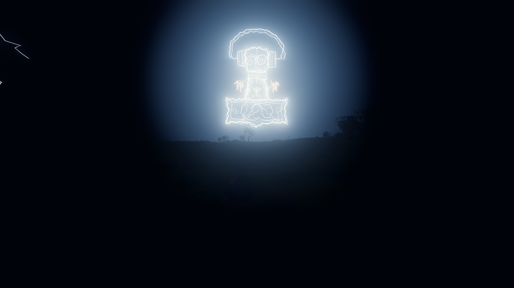

## Tu personaje

Edita tu aspecto al empezar (Nueva partida > Apariencia, o C en el juego): rostro base, tono de piel y rasgos, pelo,
barba y ropa con sus tintes, o pulsa Aleatorio. Mejoras haciendo: correr, nadar, talar, cazar, pescar, cocinar,
construir… cada habilidad sube del 1 al 30 (N abre el panel).

| | |
|---|---|
| 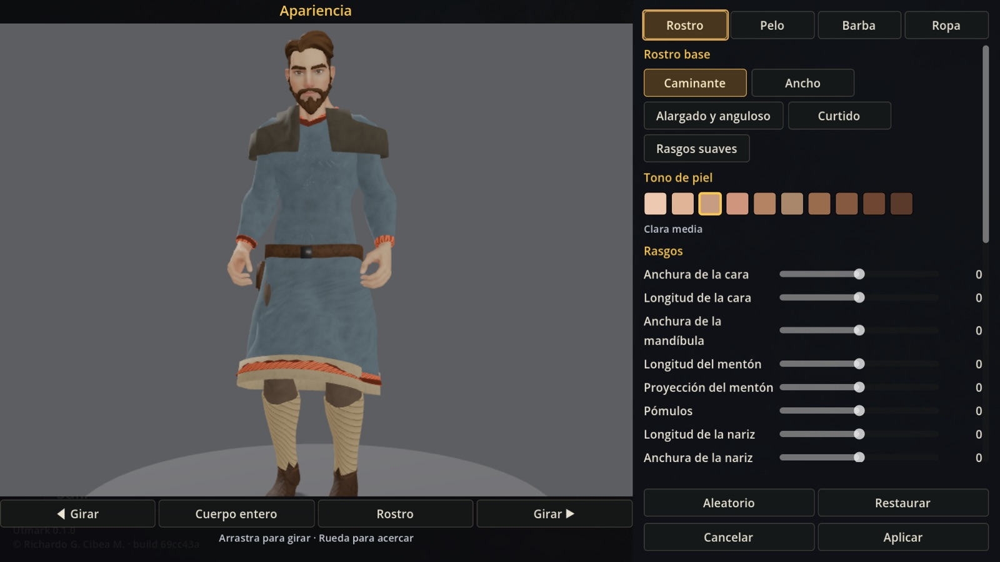 | 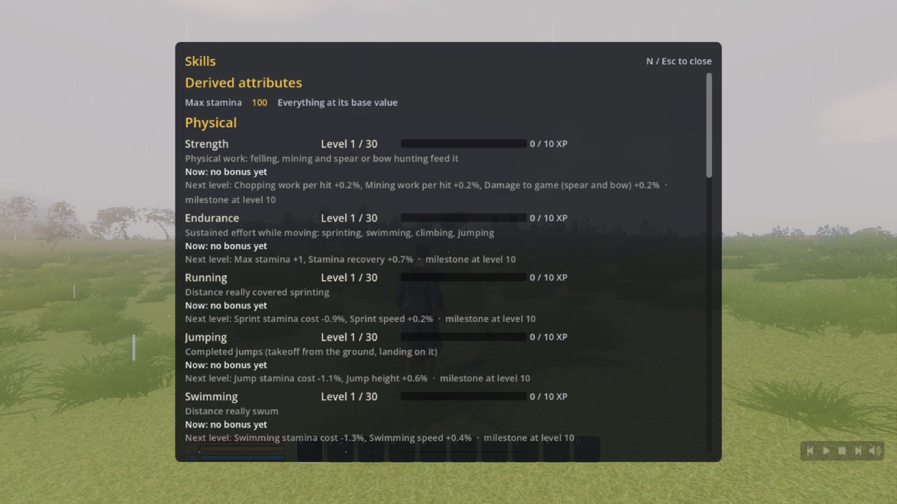 |

## Jugar juntos (cooperativo)

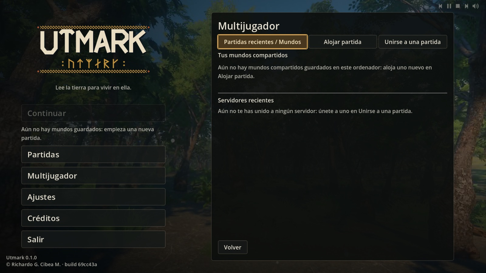

**Multijugador > Alojar partida** (4 jugadores por defecto; quien aloja puede cambiarlo, con contraseña opcional). Tus
amigos van a **Unirse a una partida**: las partidas de la red local aparecen solas en la lista; si no, escriben tu IP o
nombre y el puerto. Chat con Enter, gestos con G.

- **Por Internet:** quien aloja abre (*port forwarding*) el **puerto UDP 47777** de su router hacia su ordenador. Si tu
  operador usa CGNAT (sin IP pública propia), usad una VPN como Tailscale o WireGuard.
- Todos necesitan **la misma versión** del juego; si no coincide, el juego lo dice y propone actualizar.
- El tráfico aún no va cifrado: juega con gente de confianza.

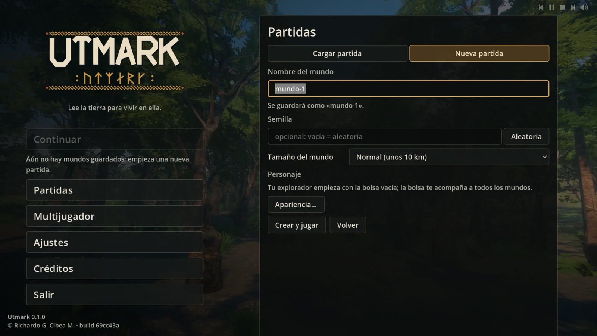

## Instalar

### macOS
1. Descarga `Utmark-X.Y.Z-macos.zip` de la [última versión](../../releases/latest) y descomprímelo.
2. **Mueve `Utmark.app` a la carpeta Aplicaciones** (así puede actualizarse sola).
3. La app no está notarizada: la primera vez, clic derecho > **Abrir**; en macOS 15 o posterior, *Ajustes del Sistema >
   Privacidad y seguridad > Abrir igualmente*.

### Windows
1. Descarga `Utmark-X.Y.Z-windows.zip` de la [última versión](../../releases/latest).
2. Descomprímelo en **una carpeta tuya** (no en `Archivos de programa`) y abre `Utmark.exe`.
3. SmartScreen: **Más información > Ejecutar de todas formas** (el ejecutable aún no está firmado).

> La versión de Windows se genera con cada publicación, pero todavía no se ha probado en Windows.

### Requisitos (orientativos)
| | |
|---|---|
| macOS | macOS 13 o posterior, Apple Silicon. Intel: incluido, sin probar |
| Windows | Windows 10/11 de 64 bits, gráfica compatible con Vulkan |
| Memoria / disco | 8 GB de RAM (16 GB recomendados) · ~1 GB libre |

## Actualizaciones

Al abrir el juego, Utmark mira si hay una versión nueva (también desde el menú principal: **Buscar actualizaciones**).
Si la hay, te enseña las novedades y pregunta **Actualizar** o **Más tarde**. Al aceptar descarga la versión nueva,
comprueba su firma y su suma SHA-256, se cierra, se sustituye y se vuelve a abrir; si la nueva no arranca, vuelve a la
anterior. **Tus mundos, personajes y ajustes no se tocan.** Sin conexión, el juego funciona igual.
Historial de cambios: [Releases](../../releases).

## Controles básicos
| Tecla | Acción |
|---|---|
| W A S D, ratón | Moverse y mirar |
| Espacio · Mayús · Ctrl | Saltar · correr · agacharse |
| E / F | Usar (coger, abrir, añadir leña, llenar agua) / otras acciones (verter, encender o apagar) |
| Clic izquierdo · clic derecho | Golpear, tensar el arco, lanzar las runas · comer o beber |
| Tab · 1–9, 0 · X | Inventario y fabricación · objeto en la mano · enfundar |
| B · R · Z | Construir · girar la pieza · desmontar |
| O | Colgar o recoger la olla |
| M · N · C | Mapa · habilidades · apariencia |
| Enter · G · P | Chat · gestos · jugadores (en línea) |
| Esc · F1 | Pausa · Ajustes > Controles (todo se puede reasignar) |

## Créditos
Hecho con [Godot](https://godotengine.org) por **Richardo G. Cibea M.** El personaje parte de los *Universal Base
Characters* de Quaternius (CC0); los efectos de sonido son CC0. La música es original de Utmark (*Utmark — Original
Soundtrack*, © Richardo G.C., todos los derechos reservados), interpretada con muestras CC0.
Este repositorio solo contiene las versiones publicadas del juego; el código fuente no es público.

---

## English

**Utmark** is a survival, exploration and building game in a wild northern land that you learn to read: height,
wind, water and rock decide where the woods grow, where snow lies and where a caldera steams. Playable, in development:
explore seeded worlds (about 10 km, rivers and lakes, seven ecosystems, nine kinds of weather), gather and craft,
build Hedeby houses (three ready-made houses plus their pieces; take a whole house down for a full refund), keep water in
wells and troughs, cook three dishes at once on a hearth, hunt red deer and boar with spear and bow (trajectory preview
and target highlight), fish, read the hunt with rune casts, survive Thor's strike in a storm, edit your character's
look, grow 1–30 skills, and play co-op. English and Spanish.

**Install**
- **macOS:** download `Utmark-X.Y.Z-macos.zip` from the [latest release](../../releases/latest), unzip it and **move
  `Utmark.app` to Applications** (needed for self-updates). Not notarized: the first time, right-click > **Open**
  (macOS 15+: *System Settings > Privacy & Security > Open Anyway*).
- **Windows:** download `Utmark-X.Y.Z-windows.zip`, unzip it into **a folder you own** (not `Program Files`) and run
  `Utmark.exe`; SmartScreen: **More info > Run anyway**. The Windows build is produced with every release but has not
  been tested on Windows yet.

**Requirements (indicative):** macOS 13+ on Apple Silicon (Intel included, untested) · Windows 10/11 64-bit with a
Vulkan-capable GPU · 8 GB RAM (16 GB recommended) · about 1 GB of disk.

**Co-op:** main menu > **Multiplayer > Host a game** (4 players by default, optional password); friends use **Join a
game**: LAN games are listed automatically, otherwise type the host's IP or name and port. Over the Internet the host
forwards **UDP port 47777** on the router; behind CGNAT use a VPN such as Tailscale or WireGuard. Everyone needs the
same game version. Traffic is not encrypted yet: play with people you trust.

**Updates:** at launch (and from **Check for updates** in the main menu) the game looks for a new version, shows its
notes and asks **Update** or **Later**. Updating downloads it, checks its signature and SHA-256, restarts into the new
version and rolls back if it fails to start. Your worlds, characters and settings are never touched. Changelog:
[Releases](../../releases).

**Controls:** W A S D + mouse · Space jump · Shift run · Ctrl crouch · E use · F other actions · left click
attack / draw the bow / cast runes · right click eat or drink · Tab inventory · 1–9, 0 hotbar · B build · Z take down ·
O hang the pot · M map · N skills · C appearance · Enter chat · G gestures · Esc pause · F1 rebind every control.

**Credits:** made with Godot by **Richardo G. Cibea M.** Character based on Quaternius' *Universal Base Characters*
(CC0); CC0 sound effects; original music (© Richardo G.C., all rights reserved), played with CC0 samples. This
repository only holds the published builds; the source code is not public.
