

  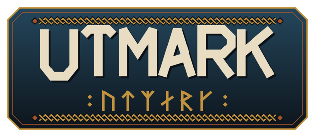

<b>Lee la tierra para vivir en ella.</b> · <i>Read the land to live in it.</i>

  <a href="../../releases/latest"><b>⬇ Descargar la última versión / Download the latest version</b></a>
  · <a href="#english">English below</a>

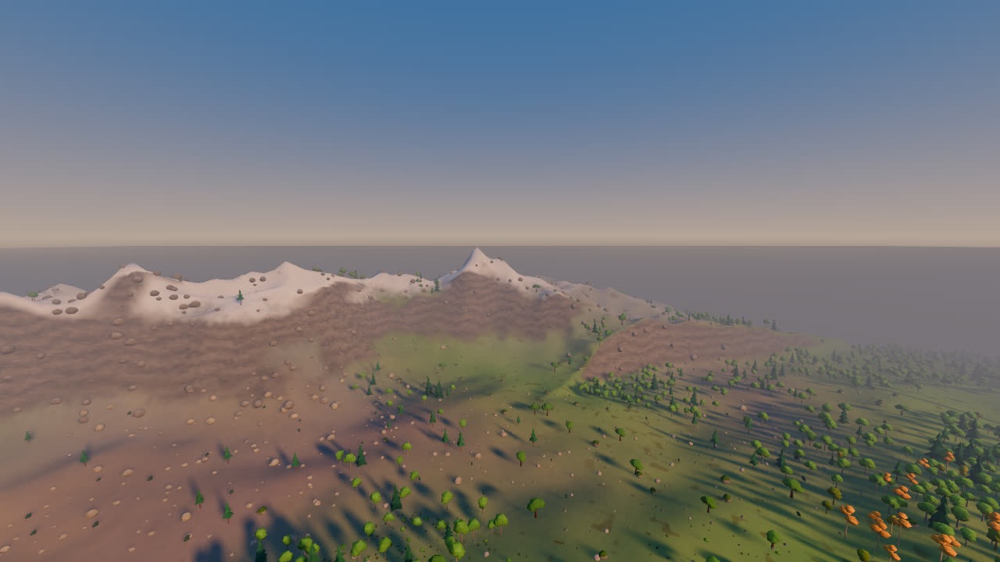

**Utmark** es un juego de supervivencia, exploración y construcción en una tierra salvaje del norte que aprendes a
leer. El nombre es la palabra escandinava para la tierra de fuera de la cerca de la granja: la que no se cultiva sino
que se recorre, y se aprovecha estación a estación para pastos, juncos, turba, piedra, sal y leña.

En Utmark el paisaje se explica solo. La altura, el viento, el agua y la roca deciden dónde crecen los bosques, dónde
se acumula la nieve, dónde el suelo se vuelve juncal y dónde humea una caldera. Explorar es prever y comprobar:
*detrás de esa cresta el viento llega seco, así que debería haber páramo abierto.*

> **Estado:** en desarrollo temprano. Se puede explorar, recolectar, fabricar, construir, cocinar, cazar, pescar y
> jugar en cooperativo hasta 4 personas. Cada versión nueva llega con el actualizador del juego.

## Qué puedes hacer

### Un mundo que se lee
Cada semilla da un mundo propio de unos 10 km: tierras e islas separadas por estrechos, crestas, mesetas, una costa
irregular y algunas calderas. Siete ecosistemas (Valles del Alba, Sotos de Ámbar, Cuencas de Junco, Páramos de Sílex,
Altos de Escarcha, Costas de Sal y Calderas de Ascua) y el mar, cada uno con su suelo, sus plantas, su luz y su tiempo.
El mapa se dibuja como un mapa de campo, con curvas de nivel, escala y una rosa de los vientos.

| | |
|---|---|
| 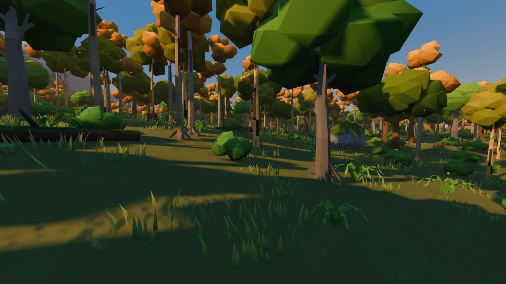 | 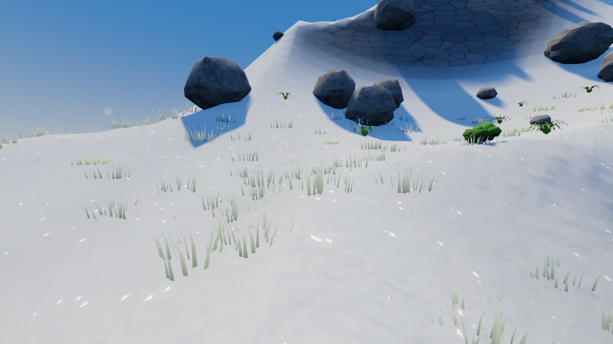 |
| 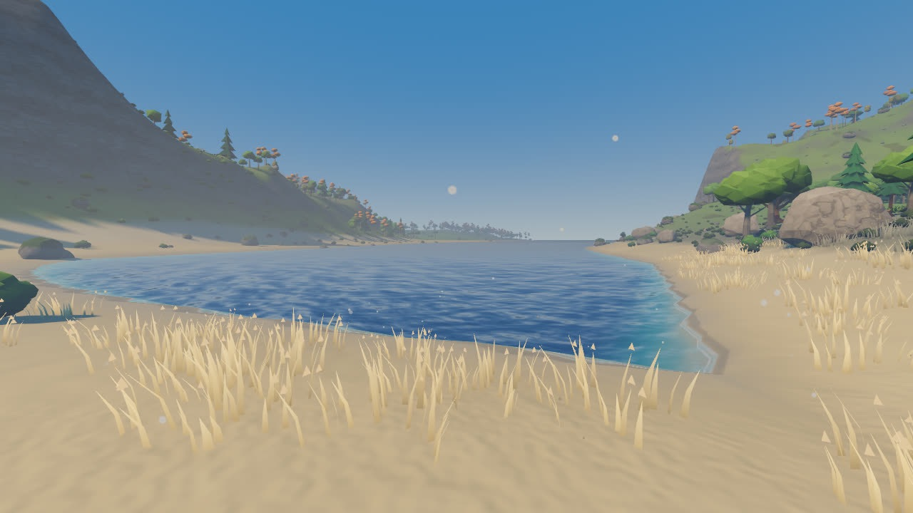 | 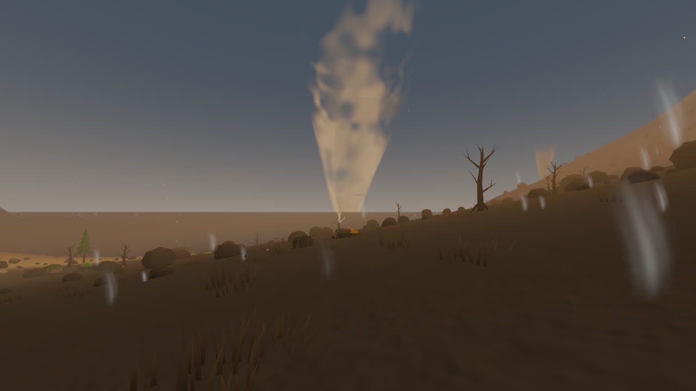 |

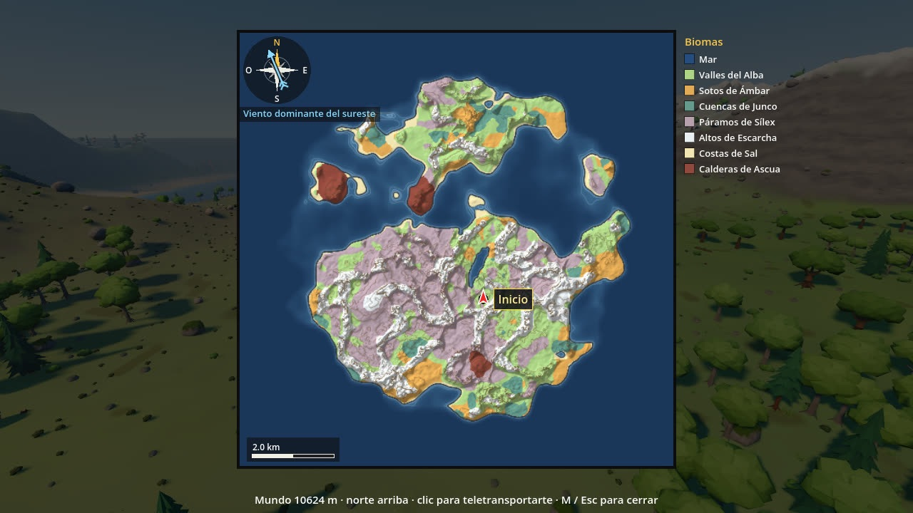

### Tiempo con causa
Nueve tipos de tiempo (despejado, niebla, llovizna, lluvia, tormenta, vendaval, nieve, ventisca y ceniza) que dependen
del ecosistema. Las tormentas oscurecen el cielo y lanzan rayos; el mar sube con el viento y moja la arena.

### Sobrevivir, fabricar y construir
Salud, hambre y sed; setas, bayas, carne y pescado; agua de río, de lago (hiérvela) o de pozo. Fabrica herramientas,
monta una hoguera, cuelga la olla de esteatita y cocina. Levanta una casa de troncos con cimientos de piedra, puerta,
tejado, antorchas y un hogar con chimenea que saca el humo. Si mueres, tus cosas quedan en un túmulo de piedras donde
caíste: vuelve a por ellas.

| | |
|---|---|
|  | 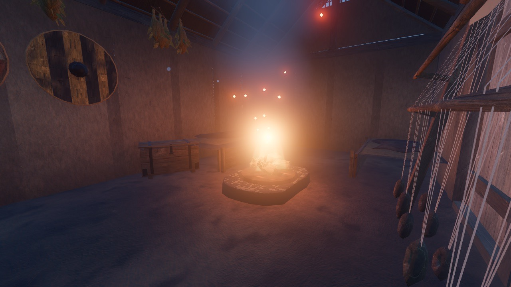 |
| 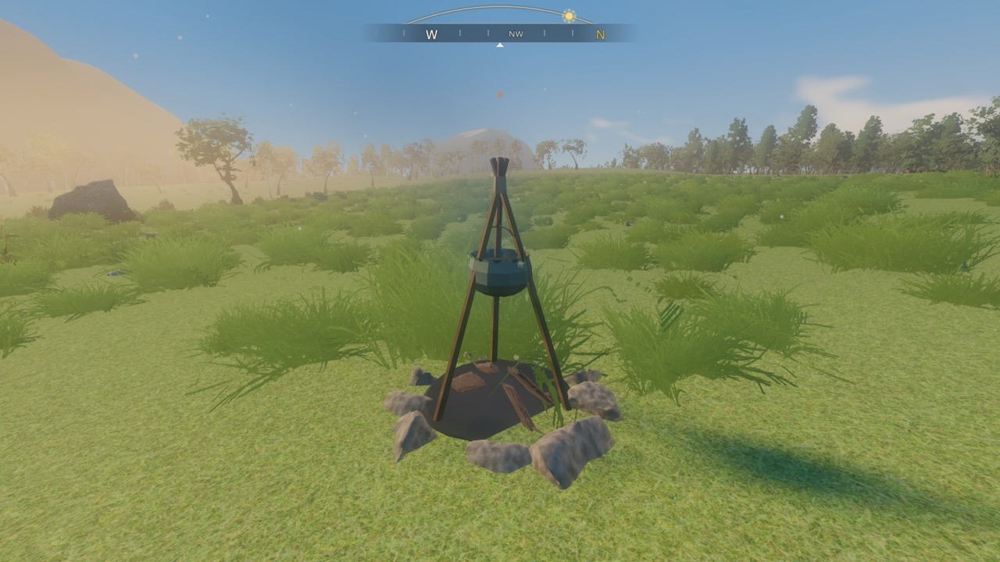 | 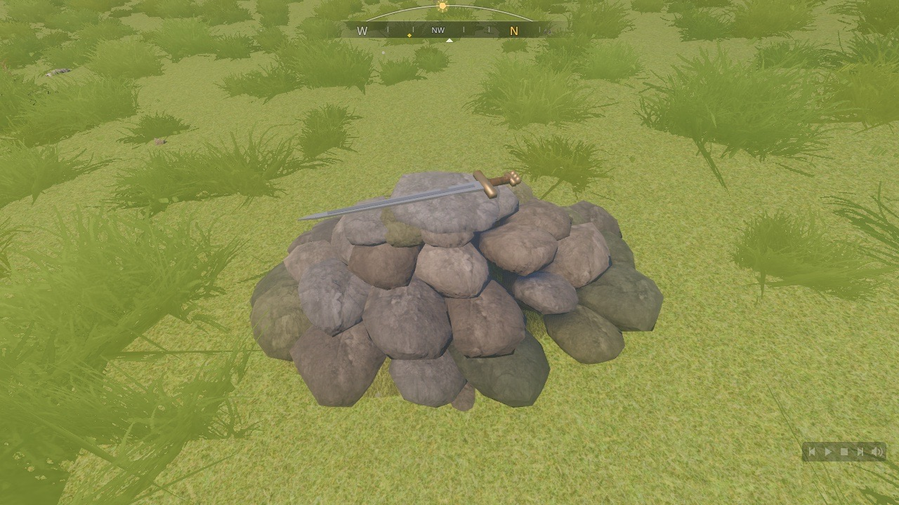 |

### Mejorar haciendo
Dieciocho habilidades que suben con lo que de verdad haces: correr, nadar, talar, cazar, pescar, cocinar, construir…
Cada nivel trae una ventaja pequeña pero real. Las runas del cazador te dicen hacia dónde buscar caza.

### Jugar juntos (cooperativo, hasta 4)
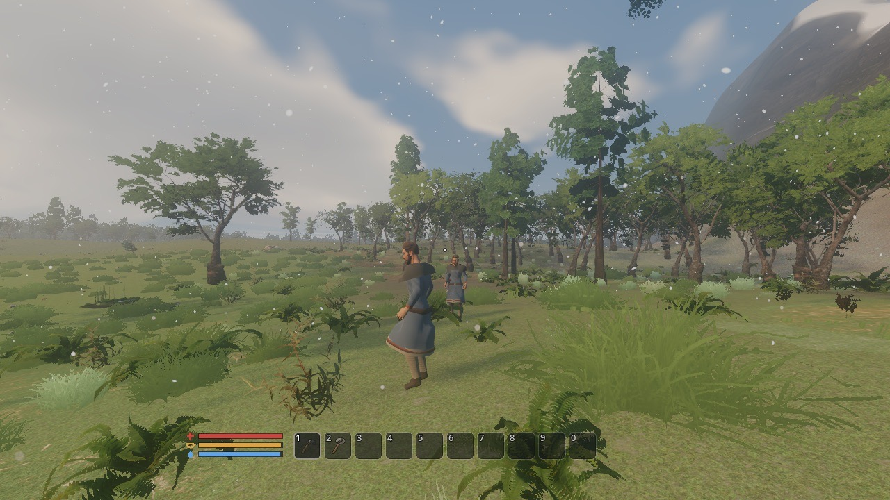

En el menú principal: **Multijugador > Alojar**. Tus amigos eligen **Unirse** y escriben tu IP (o nombre) y puerto.
Todos comparten el mundo: recolección, construcción, fuegos, animales y la noche (pasa cuando todos se acuestan).

- **Red local:** funciona sin más; las partidas de la red aparecen solas en la lista.
- **Por Internet:** quien aloja abre (*port forwarding*) el **puerto UDP 47777** en su router hacia su ordenador.
  Si tu operador usa CGNAT (no tienes IP pública propia), usad una VPN como Tailscale o WireGuard.
- Todos deben tener **la misma versión** del juego; si no, el juego lo dice y propone actualizar.
- El tráfico aún no va cifrado: juega con gente de confianza.

### Español e inglés
Todo el juego en español o en inglés; se cambia en Ajustes sin reiniciar.

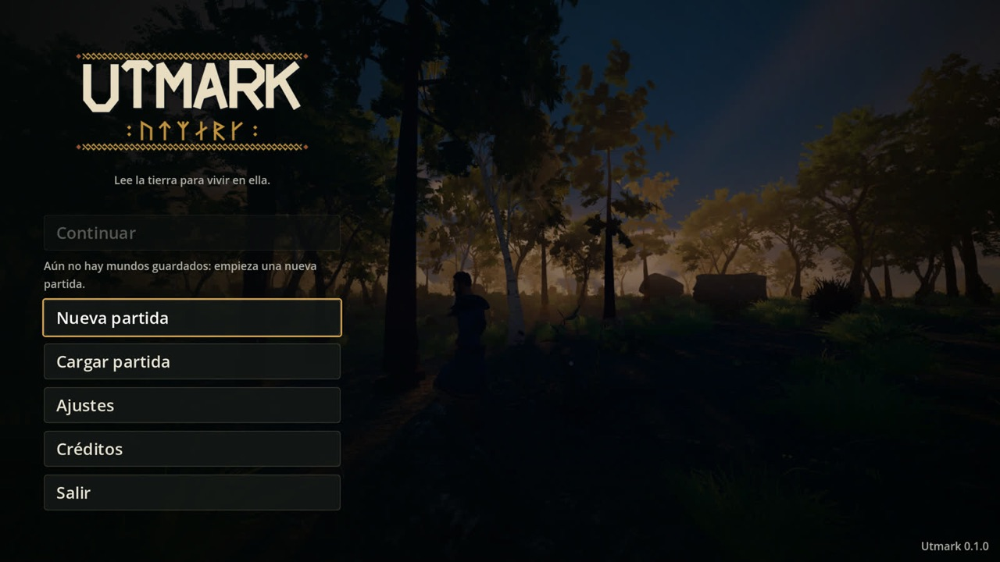

## Instalar

### macOS
1. Descarga `Utmark-X.Y.Z-macos.zip` de la [última versión](../../releases/latest) y descomprímelo.
2. **Mueve `Utmark.app` a la carpeta Aplicaciones** (necesario para que se pueda actualizar sola).
3. La primera vez macOS avisa de que la app no está notarizada: clic derecho > **Abrir**; en macOS 15 o posterior,
   *Ajustes del Sistema > Privacidad y seguridad > Abrir igualmente*.

### Windows
1. Descarga `Utmark-X.Y.Z-windows.zip` de la [última versión](../../releases/latest).
2. Descomprímelo en **una carpeta tuya** (por ejemplo `Documentos\Juegos\Utmark`; no en `Archivos de programa`, para
   que pueda actualizarse sola) y abre `Utmark.exe`.
3. Si aparece SmartScreen: **Más información > Ejecutar de todas formas** (el ejecutable aún no está firmado).

> La versión de Windows se genera con cada publicación pero todavía no se ha probado a fondo en Windows.

### Requisitos (orientativos)
| | Mínimo |
|---|---|
| macOS | macOS 13 o posterior, Apple Silicon (M1 o superior). Intel: incluido, sin probar |
| Windows | Windows 10/11 de 64 bits, tarjeta gráfica compatible con Vulkan |
| Memoria | 8 GB de RAM (16 GB recomendados) |
| Disco | ~1 GB libre |

## Actualizaciones
Al abrir el juego, Utmark mira si hay una versión nueva (también desde el menú principal: **Buscar actualizaciones**).
Si la hay, te enseña las novedades y te pregunta: **Actualizar** o **Más tarde**. Al aceptar, descarga la versión
nueva, comprueba su firma y su suma SHA-256, se cierra, se sustituye y se vuelve a abrir. Si algo sale mal, vuelve a
la versión anterior. **Tus mundos, personajes y ajustes no se tocan.** Sin conexión, el juego funciona igual.

Historial de cambios: [Releases](../../releases).

## Controles básicos
| Tecla | Acción |
|---|---|
| W A S D, ratón | Moverse y mirar |
| Espacio · Mayús · Ctrl | Saltar · correr · agacharse |
| E / F | Usar: coger, abrir, añadir leña, llenar la cantimplora |
| Tab | Inventario y fabricación |
| B | Construir (R gira la pieza, Z la desmonta) |
| 1–9, 0 · clic derecho | Objeto en la mano · comer o beber |
| M | Mapa |
| N | Habilidades |
| Esc | Pausa, ajustes, guardar, salir |
| F1 | Ajustes > Controles: todo se puede reasignar |

## Créditos
Hecho con [Godot](https://godotengine.org) 4.7.2 por **Richardo G. Cibea M.** El personaje parte de los *Universal Base
Characters* de Quaternius (CC0); los efectos de sonido son CC0. La música es original de Utmark (*Utmark — Original
Soundtrack*, © Richardo G.C., todos los derechos reservados), interpretada con muestras CC0.

Este repositorio solo contiene las versiones publicadas del juego; el código fuente no es público.

---

## English

**Utmark** is a survival, exploration and building game set in a wild northern land that you learn to read. The
landscape explains itself: height, wind, water and rock decide where the woods grow, where the snow lies and where a
caldera steams. Early development: you can explore, gather, craft, build, cook, hunt, fish and play co-op with up to
4 players. English and Spanish.

**Install**
- **macOS:** download `Utmark-X.Y.Z-macos.zip` from the [latest release](../../releases/latest), unzip it and **move
  `Utmark.app` to Applications** (needed for self-updates). The app is not notarized: the first time, right-click >
  **Open** (macOS 15+: *System Settings > Privacy & Security > Open Anyway*).
- **Windows:** download `Utmark-X.Y.Z-windows.zip`, unzip it into **a folder you own** (not `Program Files`) and run
  `Utmark.exe`. SmartScreen: **More info > Run anyway**. The Windows build is produced with every release but has not
  been tested much on Windows yet.

**System requirements:** macOS 13+ on Apple Silicon (Intel included, untested) · Windows 10/11 64-bit with a
Vulkan-capable GPU · 8 GB RAM (16 GB recommended) · about 1 GB of disk.

**Co-op (up to 4):** main menu > **Multiplayer > Host**; friends choose **Join** and type your IP or name and port. On
a local network it just works. Over the Internet, the host forwards **UDP port 47777** on the router to their
computer; behind CGNAT, use a VPN such as Tailscale or WireGuard. Everyone needs the same game version. Traffic is not
encrypted yet: play with people you trust.

**Updates:** at launch (and from **Check for updates** in the main menu) the game looks for a new version, shows its
notes and asks **Update** or **Later**. Updating downloads it, checks its signature and SHA-256, restarts into the new
version and rolls back if it fails to start. Your worlds, characters and settings are never touched. Changelog:
[Releases](../../releases).

**Controls:** W A S D + mouse to move and look · Space jump · Shift run · Ctrl crouch · E / F use · Tab inventory and
crafting · B build · 1–9, 0 hotbar · right-click eat or drink · M map · N skills · Esc pause · F1 rebind every control.

**Credits:** made with Godot 4.7.2 by **Richardo G. Cibea M.** Character based on Quaternius' *Universal Base
Characters* (CC0); CC0 sound effects; original music (© Richardo G.C., all rights reserved), played with CC0 samples.
This repository only holds the published builds; the source code is not public.
