

  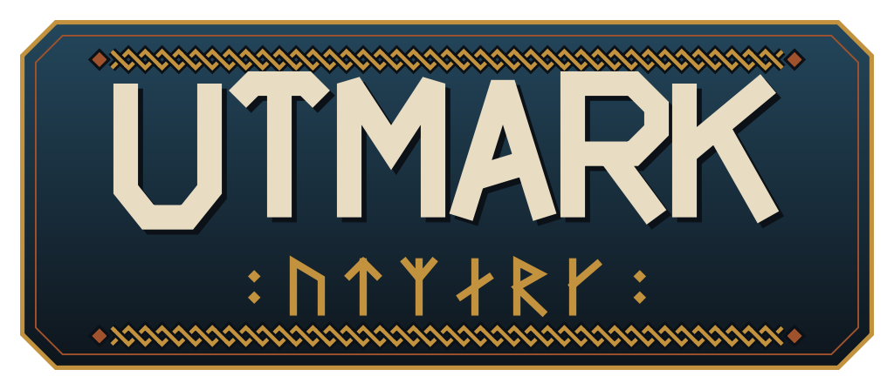

<b>Lee la tierra para vivir en ella.</b> · <i>Read the land to live in it.</i>

  <a href="../../releases/latest"><b>⬇ Descargar la última versión / Download the latest version</b></a>
  · <a href="#english">English below</a>

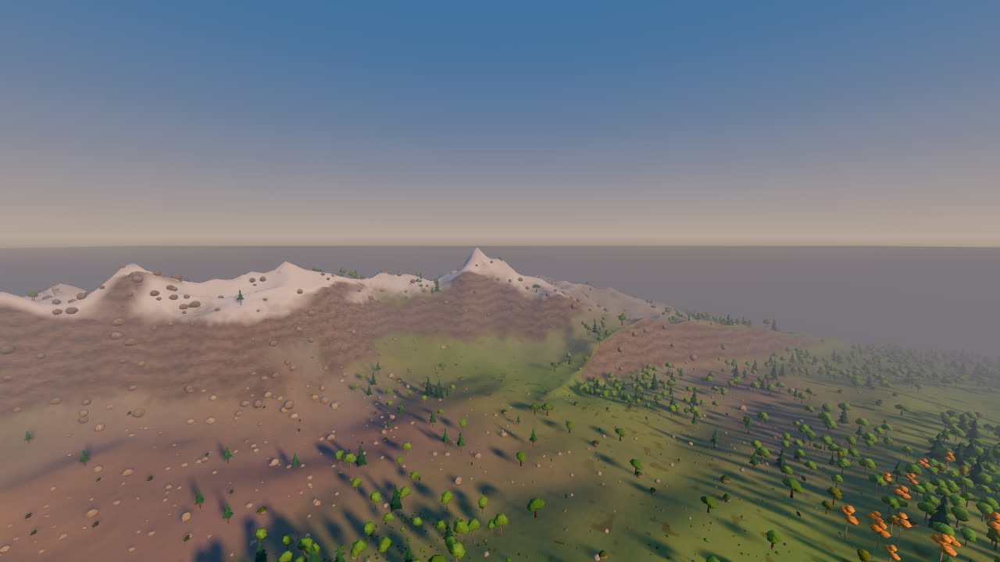

**Utmark** es un juego de supervivencia, exploración y construcción en una tierra salvaje del norte que aprendes a
leer. El nombre es la palabra escandinava para la tierra de fuera de la cerca de la granja: la que no se cultiva sino
que se recorre, y se aprovecha estación a estación (pasto, juncos, turba, piedra, sal y madera).

En Utmark el paisaje se explica solo. La altura, el viento, el agua y la roca deciden dónde crecen los bosques, dónde
se acumula la nieve, dónde el suelo se vuelve juncal y dónde humea una caldera. Explorar es predecir y comprobar:
*tras esa cresta el viento llega seco, así que debería haber páramo.* Luego recolectas, fabricas, levantas una casa
vikinga, cazas, comercias con las aldeas que encuentras, y a veces el cielo responde.

> **Estado:** jugable y en desarrollo activo. Explorar, recolectar, fabricar, cocinar, construir, cazar, pescar,
> comerciar y jugar en cooperativo hasta 4 jugadores. Cada versión nueva llega con el actualizador del juego
> ([Instalar](#instalar)).

## El mundo

### Un mundo que se puede leer
Cada semilla da un mundo propio de unos 10 km: tierras e islas separadas por estrechos, crestas y mesetas, una costa
irregular y algunas calderas. La misma semilla da siempre el mismo mundo, hasta el último árbol. Un viento dominante lo
moldea: páramos secos a sotavento de las crestas, nieve en las laderas protegidas, enebros doblados. El mapa (M) se
dibuja como un mapa de campo, con curvas de nivel, escala y rosa de los vientos; acércalo a unos cientos de metros,
pon marcadores y viaja con un clic.

| | |
|---|---|
| 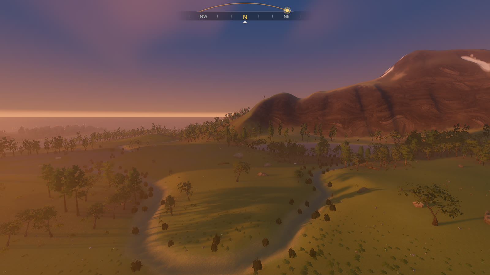 | 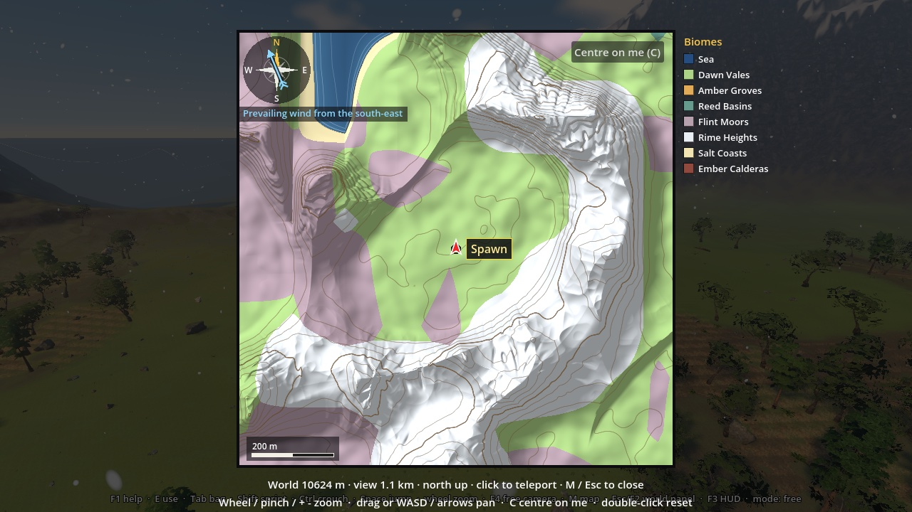 |

### Ríos, lagos y siete ecosistemas
Los ríos bajan hasta el mar y los lagos llenan las hondonadas: siempre hay agua a pocos pasos. Siete ecosistemas y el
mar, elegidos por la propia tierra, cada uno con su suelo, sus plantas, su luz, su tiempo y su vida en el aire.

| | |
|---|---|
|  **Valles del Alba**: praderas abrigadas y bosque mixto. | 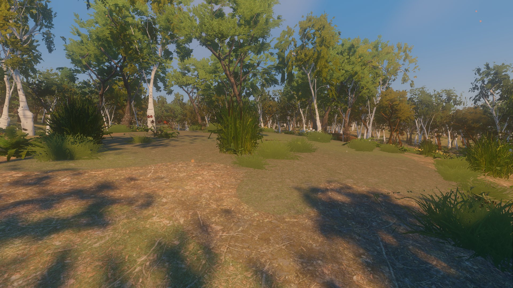 **Sotos de Ámbar**: bosques de copa dorada en la cara húmeda de las crestas. |
|  **Cuencas de Junco**: hondonadas húmedas, mosquitos y luciérnagas de noche. | 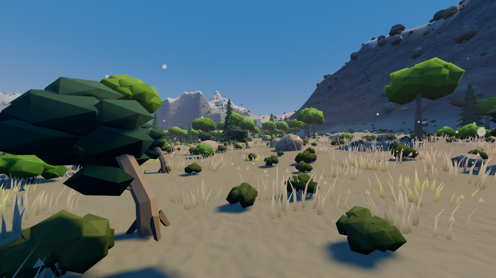 **Páramos de Sílex**: brezal abierto a sotavento. |
|  **Altos de Escarcha**: crestas frías y nieve a la deriva. |  **Costas de Sal**: dunas, calas y acantilados. |

Las Calderas de Ascua, raros puntos volcánicos de ceniza y fumarolas, completan los siete.

### Tiempo con causa
Nueve tipos de tiempo, de despejado y niebla a vendaval, ventisca y lluvia de ceniza, que se sortean cada diez minutos
y se funden con suavidad. Las cuencas son las más nubladas, los páramos reciben los vendavales y la ceniza solo cae
sobre las calderas. Las tormentas oscurecen el cielo y lanzan rayos; el mar sube con el viento y la espuma trepa por
la playa.

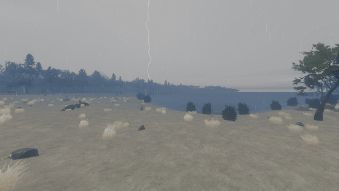

## Sobrevivir

### Come, bebe y sigue vivo
Salud, hambre y sed bajan despacio: un día dura 40 minutos y una cantimplora y una comida caliente dan para casi todo
él. Llena una cantimplora de madera en un río, hierve el agua del lago en una olla, cava un pozo, recoge lluvia en una
pila. Duerme en una cama, comido y bebido. Si mueres, tus cosas te esperan en un **túmulo vikingo** marcado en el mapa
y te levantas con unas pocas herramientas básicas.

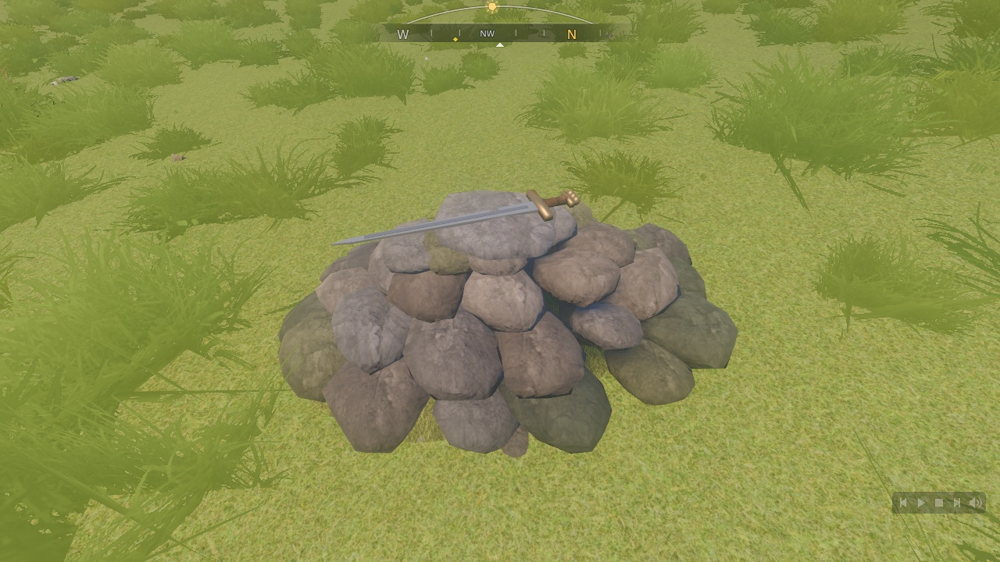

### Inventario, Fabricar y Cocinar
Tab abre el inventario sin pausar el mundo: barra rápida en 1-9 y 0, mochila y pestañas de **Fabricar** y **Cocinar**
a un lado. Fabricar lista todas las recetas con lo que tienes y lo que falta. Cocinar lista cada plato por utensilio y,
junto a un fuego, pasa a ser el menú de cocina de ese fuego: asar en espetón, cocer en una olla colgada sobre las llamas,
o dejar que un hogar de casa cocine tres platos a la vez.

| | |
|---|---|
|  | 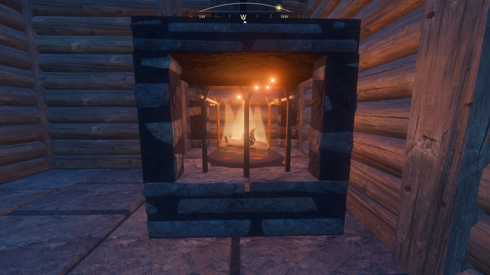 |

### Mejora haciendo
Dieciocho habilidades suben de 1 a 30 con el uso: corre y te cansas menos, tala y cada hachazo muerde más hondo,
acércate agachado y los animales tardan más en notarte. La **herbolaria** da plantas extra por cada recogida. Los
niveles 10, 20 y 30 se marcan con un brillo dorado. N abre todas las habilidades.

### Recolectar, fabricar y construir
Recoge bayas, setas y hierbas, corta leña, rompe piedra, pesca. Fabrica un hacha, una cantimplora, un espetón, un arco.
B abre el menú de construcción: cimientos de piedra, muros de troncos, puertas, suelos, vigas, escaleras, un tejado de
tablillas, **antorchas** de pie y de pared y un **hogar** de piedra con chimenea. Las piezas encajan solas y nada
flota: cada pieza necesita una cadena de apoyos hasta el suelo. Enciende una **hoguera** desde un kit; un techo guarda
de la lluvia. Las casas se ven vividas: muros combados, madera blanqueada, musgo, escudos, un telar y paja dentro.

| | |
|---|---|
|  | 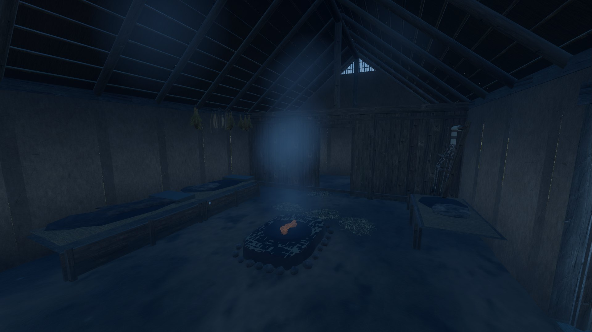 |

## Vida en la tierra

### Fauna y caza
Ciervos, liebres y peces viven según el ecosistema al que pertenecen y te notan a una distancia que puedes acortar
agachándote. Caza con lanza o **arco**: tensa, apunta, suelta, y la flecha cae con la distancia y se detiene en árboles,
rocas y muros (las flechas necesitan una pluma). En lo alto, carboneros revolotean entre los árboles, lavanderas beben
en la orilla, los **cuervos** planean sobre las crestas y los **búhos** llaman de noche.

| | |
|---|---|
| 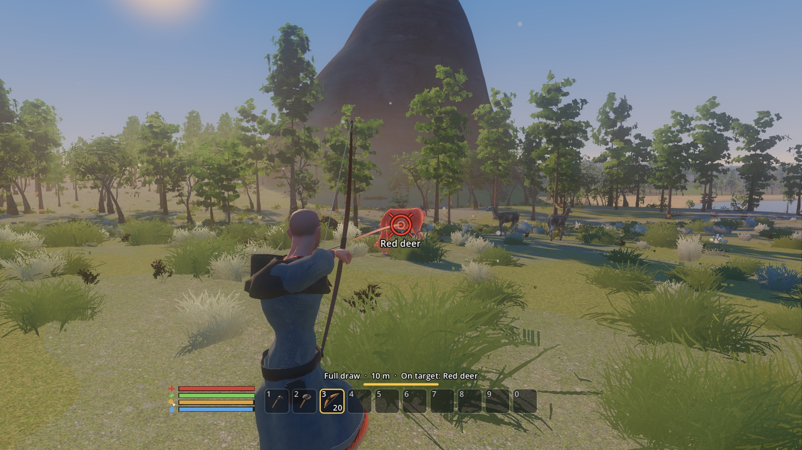 | 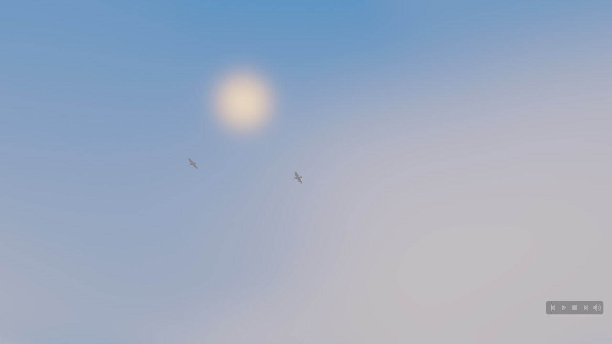 |

### Aldeas
En cada mundo hay hasta tres aldeas vikingas, con unas casas, un patio, un cofre de almacén y de dos a cuatro
**habitantes** que duermen, comen y trabajan según una rutina diaria. Encuentra una y queda marcada en el mapa, con un
contador de las halladas. Habla con un habitante: en la pestaña **Contratar** pagas a un trabajador en **pescado o
pieles** para que recoja, tale o rompa rocas y abastezca el almacén; en **Trueque** cambias tus cosas por las suyas.
Sus **gallineros** dan huevos y plumas. Una antorcha eterna arde junto a cada puerta, así que una aldea se distingue de
noche.

| | |
|---|---|
| 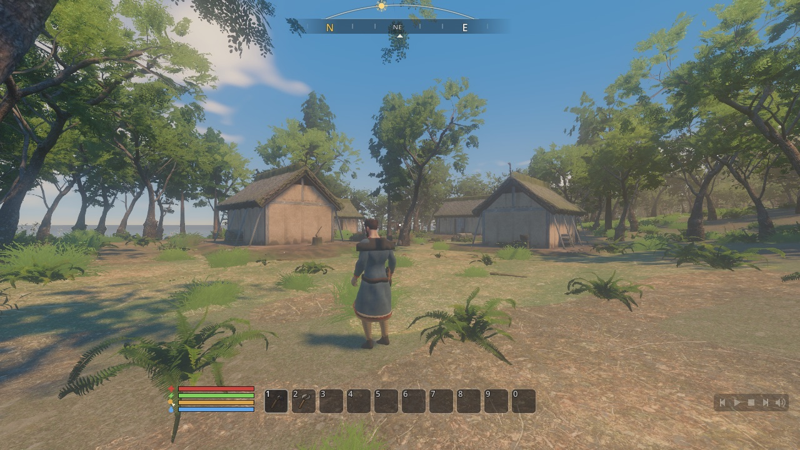 | 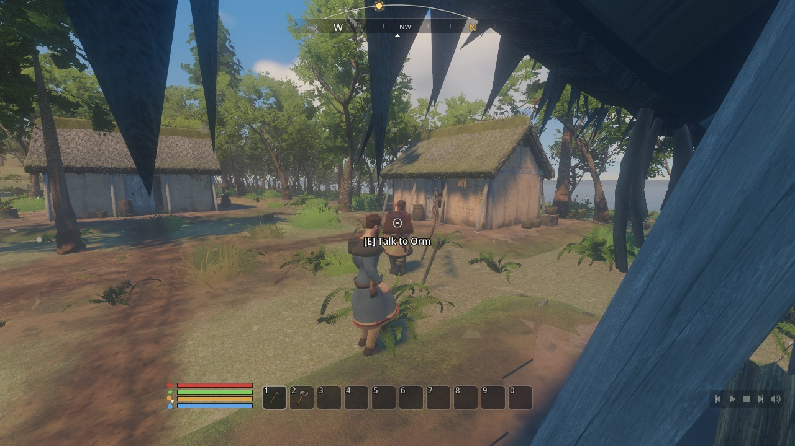 |
| 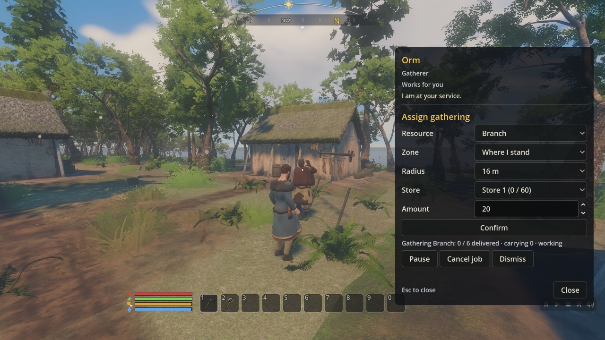 | 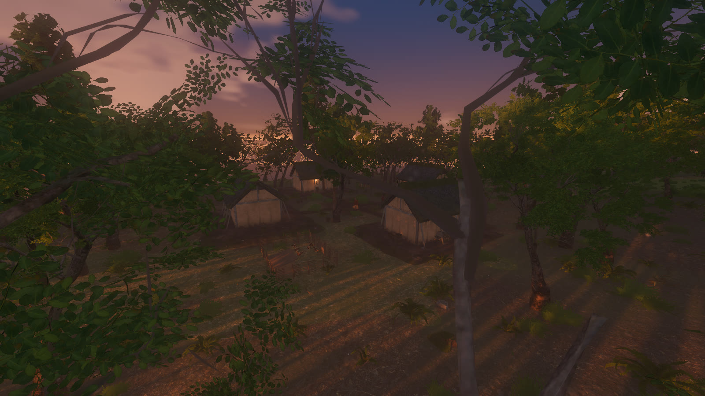 |

### Piedras en pie y runas
Piedras rúnicas, piedras pintadas, bautasteinar, barcos de piedra y círculos de piedras se alzan en cimas y costas.
Acércate a un **monolito vikingo** y sus runas brillan; queda marcado en el mapa, un aviso te dice cuántos llevas (x de
N) y su **bendición** te devuelve las tiradas de runas y te oculta de los animales durante cinco minutos. Talla un
juego de runas y **tíralo** desde el menú de fichas: la tirada del cazador dice dónde hay caza y la **tirada del
viajero** señala la aldea más cercana que aún no has encontrado.

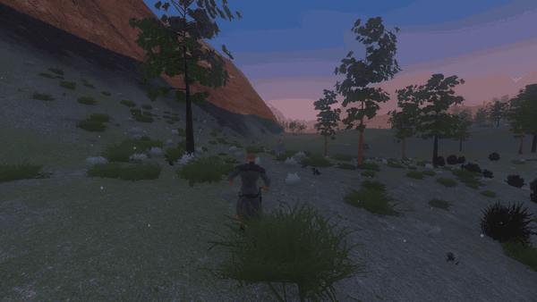

| | |
|---|---|
|  | 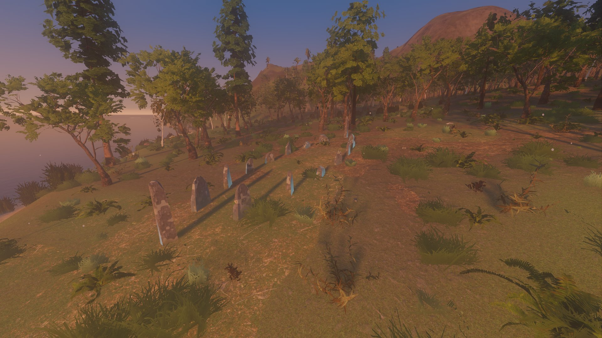 |

Los descubrimientos y otras noticias llegan como pequeños **avisos rúnicos** tallados en la esquina de la pantalla.

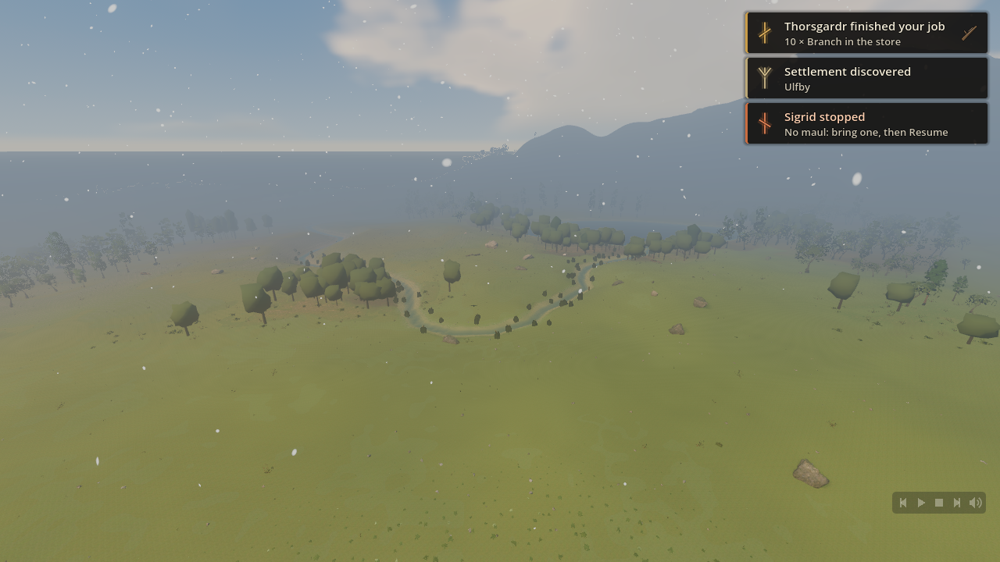

### Thor y Mjölnir
A veces el cielo responde. Se acumula el trueno, una figura se forma en las nubes y Thor dicta sentencia: puede
perdonarte y dejar en tus manos su martillo, Mjölnir, o fulminarte. Si caes, las valquirias cantan sobre tu túmulo.

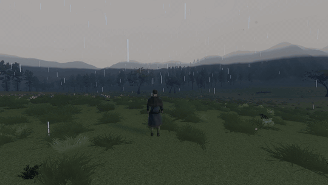

### Logros
Veinticuatro logros, desde el primer árbol hasta cada piedra en pie, en un menú que muestra el progreso, las fechas y
algunas sorpresas ocultas.

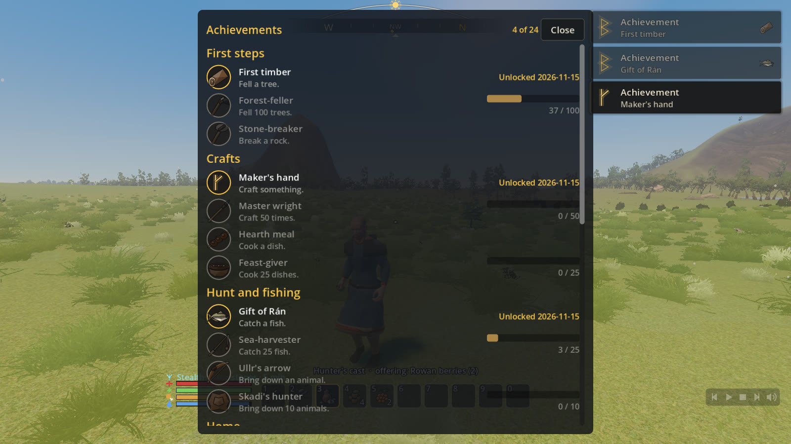

## Jugar

### Un tutorial que te espera
Un personaje nuevo recibe un tutorial corto: un consejo cada vez, tachado al hacerlo, con tus propias teclas. Cada
paso se puede saltar y «no volver a preguntar» lo aparta. Ajustes > General lo reinicia.

### Partida nueva, personaje nuevo o el mismo
Empieza un mundo desde cero o arrastra las habilidades y el inventario de una partida anterior. Escribe cualquier
semilla o ajusta el mundo (tamaño, tierra, montañas, vegetación) y regéneralo en segundos. Edita tu aspecto al empezar
(Nueva partida > Apariencia, o C en el juego).

### Música y sonido
Trece piezas originales, entre ellas siete largas y ambientales (de tres minutos y medio a cuatro) para explorar, la
noche, la costa, la montaña y el hogar, con largos silencios entre ellas. Los pasos siguen el suelo, las hachas se
hunden en la madera, y el viento, las aves, las olas y el trueno siguen dónde estás y el tiempo.

### Español e inglés
Elige el idioma en Ajustes; todos los menús, el mapa y los avisos cambian a la vez. Por defecto el juego sigue el
idioma de tu sistema.

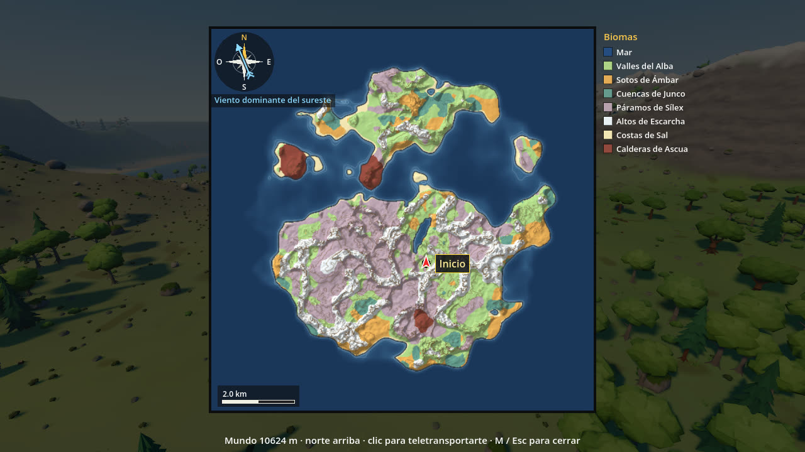

## Juntos

### Cooperativo hasta 4
Aloja un mundo desde el menú principal (uno compartido, una copia de uno tuyo o uno nuevo) y tus amigos se unen. Todos
comparten recolección, construcción, fuegos, animales y el sueño: la noche pasa cuando todos se acuestan.
**Multijugador > Alojar partida** (4 jugadores por defecto, con contraseña opcional); tus amigos van a **Unirse a una
partida**. Chat con Enter, gestos con G.
- **Red local (LAN):** las partidas de la red local aparecen solas en la lista.
- **Por Internet (WAN):** quien aloja abre (*port forwarding*) el **puerto UDP 47777** de su router hacia su ordenador.
  Si tu operador usa CGNAT, usad una VPN como Tailscale o WireGuard.
- **Servidor dedicado:** un servidor sin ventana.
- Todos necesitan **la misma versión** del juego; si no coincide, el juego lo dice y propone actualizar.
- El tráfico aún no va cifrado: juega con gente de confianza.

| | |
|---|---|
| 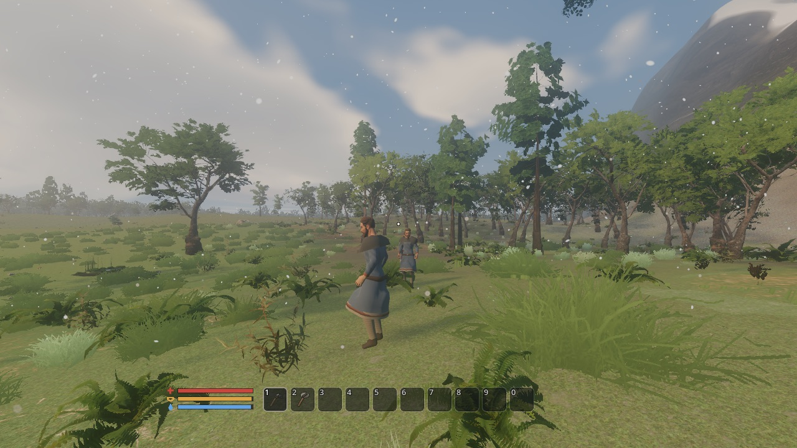 |  |

### Administración del servidor
Quien hace de autoridad (un servidor dedicado, un anfitrión o un solo jugador) puede servir un **panel de
administración web**: un mapa en vivo del mundo, los jugadores conectados, acciones de administración (expulsar,
teletransportar, tiempo, hora) y un registro de auditoría. Los **webhooks de Discord** publican eventos del servidor
(entradas, guardados, muertes, logros, descubrimientos) como mensajes con imágenes del mapa. Ambos están apagados hasta
que los activas.

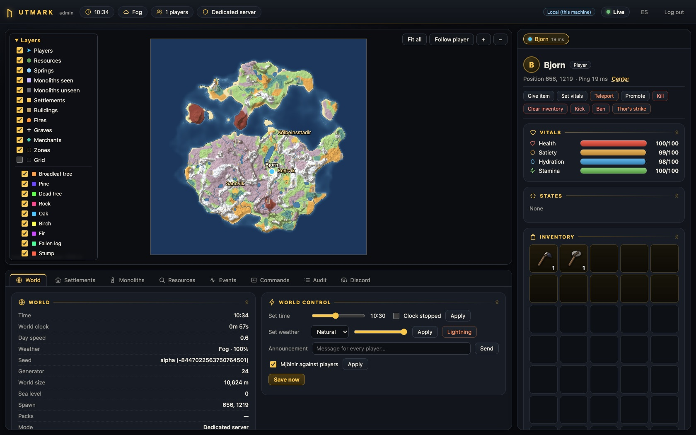

### Mods
Los paquetes de contenido son mods solo de datos que no ejecutan código: añaden ecosistemas, plantas, rocas, tiempo,
partículas, recetas, **estados de jugador**, **zonas** (áreas protegidas o de exclusión), **eventos programados** y
**logros**, y escuchan el **bus de eventos** del juego.

| | |
|---|---|
| 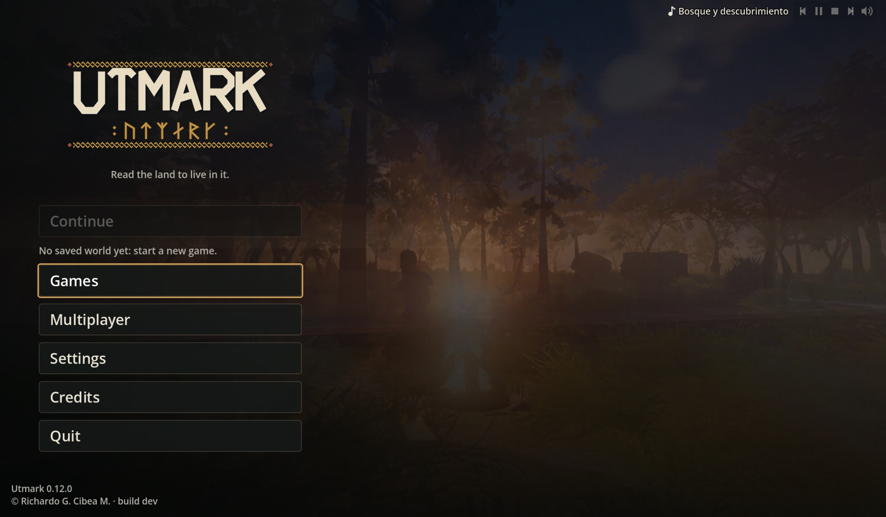 | 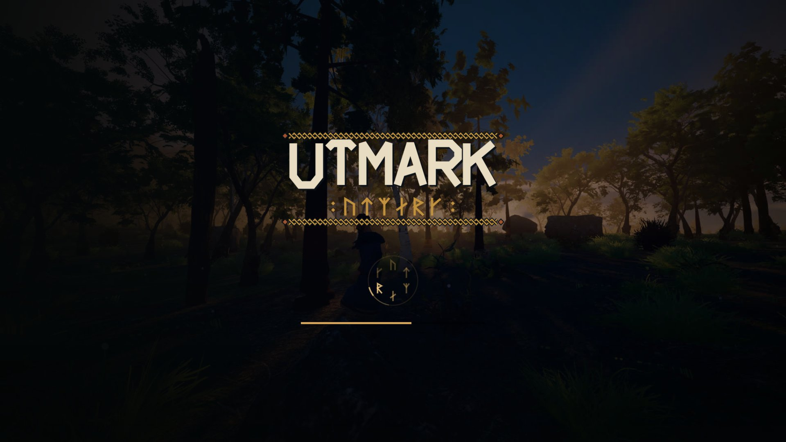 |

## Instalar

### macOS
1. Descarga `Utmark-X.Y.Z-macos.zip` de la [última versión](../../releases/latest) y descomprímelo.
2. **Mueve `Utmark.app` a la carpeta Aplicaciones** (así puede actualizarse sola).
3. La app no está notarizada: la primera vez, clic derecho > **Abrir**; en macOS 15 o posterior, *Ajustes del Sistema >
   Privacidad y seguridad > Abrir igualmente*.

### Windows
1. Descarga `Utmark-X.Y.Z-windows.zip` de la [última versión](../../releases/latest).
2. Descomprímelo en **una carpeta tuya** (no en `Archivos de programa`) y abre `Utmark.exe`.
3. SmartScreen: **Más información > Ejecutar de todas formas** (el ejecutable aún no está firmado).

> Probado sobre todo en macOS (Apple Silicon); la versión de Windows es nueva y está menos probada.

### Requisitos (orientativos)
| | |
|---|---|
| macOS | macOS 13 o posterior, Apple Silicon. Intel: incluido, sin probar |
| Windows | Windows 10/11 de 64 bits, gráfica compatible con Vulkan |
| Memoria / disco | 8 GB de RAM (16 GB recomendados) · ~1 GB libre |

## Actualizaciones
Al abrir el juego, Utmark mira si hay una versión nueva (también desde el menú principal: **Buscar actualizaciones**).
Si la hay, te enseña las novedades y pregunta **Actualizar** o **Más tarde**. Al aceptar descarga la versión nueva,
comprueba su firma y su suma SHA-256, se cierra, se sustituye y se vuelve a abrir; si la nueva no arranca, vuelve a la
anterior. **Tus mundos, personajes y ajustes no se tocan.** Sin conexión, el juego funciona igual.
Historial de cambios: [Releases](../../releases).

## Controles básicos
| Tecla | Acción |
|---|---|
| W A S D, ratón | Moverse y mirar |
| Espacio · Mayús · Ctrl | Saltar (volar arriba) · correr · agacharse (volar abajo) |
| Tab | Inventario, Fabricar y Cocinar |
| B | Construir (R gira, E coloca, Z desmonta) |
| E / F | Usar (coger, abrir, llenar, añadir leña) · F enciende o apaga un fuego o antorcha |
| 1–9, 0 | Barra rápida |
| Clic derecho | Comer o beber lo que llevas en la mano |
| M · N · C | Mapa · habilidades · apariencia |
| Enter · G | Chat · gestos |
| Esc · F1 | Pausa · Ajustes > Controles (todo se puede reasignar) |

## Hoja de ruta
Próximamente: **terraformación** (cavar y modelar el terreno), supervivencia más profunda, agricultura y más cosas que
construir y combatir. El generador del mundo puede cambiar entre versiones: un mundo de un generador anterior te dice
por qué no se puede cargar y ofrece uno nuevo con la misma semilla.

## Créditos
Hecho con [Godot](https://godotengine.org) por **Richardo G. Cibea M.** Las mallas del mundo, los shaders y la marca
son originales, generados por código. El personaje parte de los *Universal Base Characters* y la *Universal Animation
Library* de Quaternius (CC0); los efectos de sonido y ambientes son CC0. La música es original de Utmark (*Utmark —
Original Soundtrack*, © Richardo G.C., todos los derechos reservados), interpretada con muestras CC0.
Este repositorio solo contiene las versiones publicadas del juego; el código fuente no es público.

---

## English

**Utmark** is a survival, exploration and building game set in a wild northern land that you learn to read. The name
is the Scandinavian word for the outlying land beyond the farm's fence: land that is not farmed but walked, and used
season by season for grazing, reeds, peat, stone, salt and wood.

In Utmark the landscape explains itself. Height, wind, water and rock decide where the woods grow, where the snow lies,
where the ground turns to reeds and where a caldera steams. Exploring means predicting and checking: *behind that
ridge the wind arrives dry, so there should be open moorland.* Then you gather, craft, build a Viking house, hunt,
trade with the hamlets you find, and sometimes the sky answers.

**Status.** Playable and in active development. Explore, gather, craft, cook, build, hunt, fish, trade and play co-op
with up to 4 players. New versions arrive through the in-game updater ([Install](#install)).

### What you will find
- **A world you can read.** Seeded worlds of about 10 km: islands, ridges, rivers that run to the sea, lakes, and
  seven ecosystems (Dawn Vales, Amber Groves, Reed Basins, Flint Moors, Rime Heights, Salt Coasts and the rare Ember
  Calderas) chosen by the land itself. The same seed always gives the same world. A field-style map with contours, a
  scale bar and a wind rose, zoomable to a few hundred metres, with markers and click-to-travel.
- **Weather with a cause.** Nine kinds, from fog to gale, blizzard and ashfall, with storms, lightning, rising surf.
- **Survive.** Health, hunger and thirst; 40-minute days; fill flasks at rivers, boil lake water, dig wells, catch
  rain. If you die, your things wait in a Viking cairn marked on the map.
- **Inventory, Craft and Cook.** Tab opens it without pausing the world. Cook becomes the cooking menu of the fire you
  stand at: spit, hanging pot, or a house hearth cooking three dishes at once.
- **Get better by doing.** Eighteen skills from 1 to 30, with golden milestones at 10, 20 and 30.
- **Build.** Stone foundations, log walls, doors, floors, beams, stairs, shingled roofs, torches and a hearth with a
  chimney. Pieces snap into place and every piece needs a chain of supports to the ground.
- **Fauna and hunting.** Deer, hares, fish; spear or **bow** (arrows drop over distance and stop at obstacles);
  tits, wagtails, ravens and owls overhead.
- **Settlements.** Up to three Viking hamlets per world with inhabitants on a daily routine: hire workers (paid in
  fish or hides), barter, collect eggs and feathers from their hen pens. An eternal torch burns by every door.
- **Standing stones and runes.** Runestones, picture stones, stone ships and circles. Their blessing restores your
  rune casts and hides you from animals; the Hunter's cast finds game and the Traveller's cast points to the nearest
  undiscovered settlement. News arrives as carved rune notices.
- **Thor and Mjölnir.** Sometimes the sky answers: Thor may spare you and leave his hammer, or strike you down.
- **Achievements, tutorial, music.** Twenty-four achievements, a tutorial that waits for you, thirteen original
  pieces (seven long ambient ones), and sound that follows the ground, the weather and where you are.
- **English and Spanish.** Pick the language in Settings; by default the game follows your system.
- **Together.** Co-op up to 4 over LAN, WAN or a dedicated server; a web admin dashboard with a live map; Discord
  webhooks; and data-only mods (ecosystems, plants, recipes, player states, zones, scheduled events, achievements).

| | |
|---|---|
|  |  |
|  |  |

### Install
- **macOS:** download `Utmark-X.Y.Z-macos.zip` from the [latest release](../../releases/latest), unzip it and **move
  `Utmark.app` to Applications** (needed for self-updates). Not notarized: the first time, right-click > **Open**
  (macOS 15+: *System Settings > Privacy & Security > Open Anyway*).
- **Windows:** download `Utmark-X.Y.Z-windows.zip`, unzip it into **a folder you own** (not `Program Files`) and run
  `Utmark.exe`; SmartScreen: **More info > Run anyway**. Tested mostly on macOS (Apple Silicon); the Windows build is
  new and less tested.

**Requirements (indicative):** macOS 13+ on Apple Silicon (Intel included, untested) · Windows 10/11 64-bit with a
Vulkan-capable GPU · 8 GB RAM (16 GB recommended) · about 1 GB of disk.

### Updates
At launch (and from **Check for updates** in the main menu) the game looks for a new version, shows its notes and
asks **Update** or **Later**. Updating downloads it, checks its signature and SHA-256, restarts into the new version
and rolls back if it fails to start. Your worlds, characters and settings are never touched. Changelog:
[Releases](../../releases).

### Co-op
Main menu > **Multiplayer > Host a game** (4 players by default, optional password); friends use **Join a game**: LAN
games are listed automatically. Over the Internet the host forwards **UDP port 47777** on the router; behind CGNAT use
a VPN such as Tailscale or WireGuard. A dedicated server runs without a window. Everyone needs the same game version.
Traffic is not encrypted yet: play with people you trust.

### Controls
W A S D + mouse · Space jump (fly up) · Shift run · Ctrl crouch (fly down) · Tab inventory, Craft and Cook · 1–9, 0
hotbar · E use · F light or put out a fire or torch · right click eat or drink · B build (R turns, E places, Z takes
down) · M map · N skills · C appearance · Enter chat · G gestures · Esc pause · F1 rebind every control.

### Roadmap
Planned next: terraforming (digging and shaping the ground), deeper survival, farming, and more to build and fight.
The world generator may change between versions: a world from an older generator tells you why it cannot load and
offers a new one with the same seed.

### Credits
Made with [Godot](https://godotengine.org) by **Richardo G. Cibea M.** All world meshes, shaders and branding are
original, generated by code. The character is based on Quaternius' *Universal Base Characters* and *Universal
Animation Library* (CC0); sound effects and ambiences are CC0. The music is original (*Utmark — Original Soundtrack*,
© Richardo G.C., all rights reserved), played with CC0 samples. This repository only holds the published builds; the
source code is not public.
